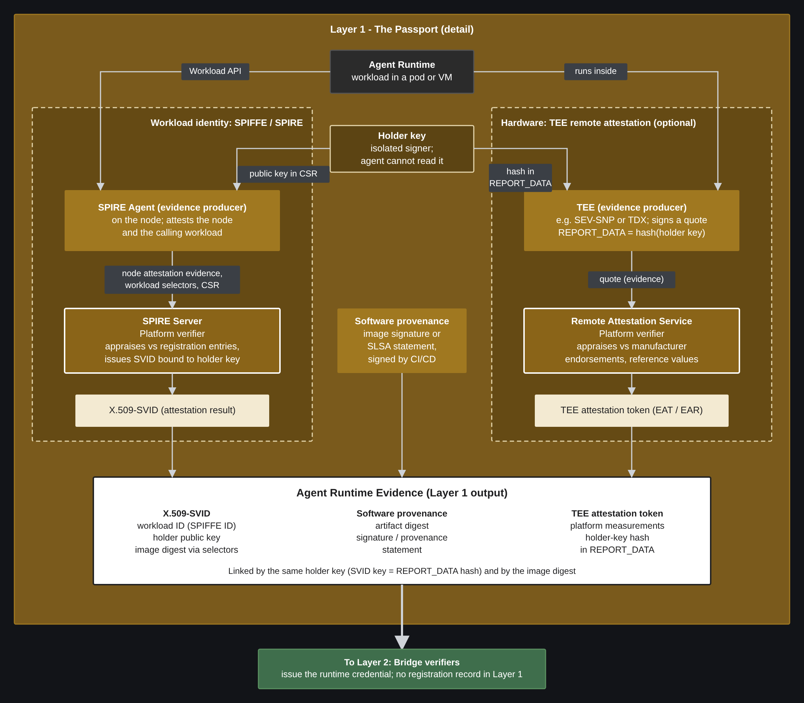

# The ODIS Passport

## Summary

ODIS divides agent access across three layers. The [Passport](../ODIS.md#31-layer-1--the-passport-identity--attestation) describes the agent's software and running instance; the [Bridge](../ODIS.md#32-layer-2--the-bridge-delegation--access) records who the agent acts for and what authority it holds; the [Router](../ODIS.md#33-layer-3--the-router-discovery--governance) governs calls to tools and services.

This document specifies the Passport. The Passport produces evidence and platform-level results, and never consults the Agent Registration Record. Its platform verifiers, such as a SPIRE server or a TEE remote attestation service, appraise the evidence within their own remit and issue results such as SVIDs and attestation tokens; those results travel to the Bridge as evidence alongside the rest. Every check that needs the record (which logical agent this is, whether its software and components are approved, whether it is active) happens in the Bridge. The Passport contains the Attesters and platform verifiers; the Bridge appraises their evidence.

## 1. Layer 1 — The Passport

**Addresses:** Pillar 2 (agent code/package identity) and Pillar 3 (agent runtime instance identity). **Role:** Produces the evidence that shows WHAT software is running and WHICH runtime instance is running it.

The Passport establishes, with evidence the agent cannot author, that a specific software artifact and set of components is running as a specific runtime instance holding a specific key. It does not decide whether that instance may act; that decision belongs to the Bridge.

ODIS follows the RATS passport model: the presenter carries appraisal results to each relying party, and no relying party contacts the appraiser per call. The Passport is the first step in that model.

ODIS does not mandate a specific evidence technology. Conformant implementations MAY use:

- SPIFFE/SPIRE node and workload attestation
- Cloud-native workload identity
- Container image signatures and supply-chain provenance statements
- TEE or TPM remote attestation
- Any mechanism satisfying the requirements in Section 4

### 1.1 Terminology

ODIS distinguishes the following Passport terms. *Model-visible process* is used as defined in [ODIS §1.4](../ODIS.md#14-normative-terminology).

1. **Agent Runtime Evidence:** the set of evidence objects the Passport produces for one runtime instance and delivers to the Bridge (Section 5).
2. **Evidence producer:** a component outside the model-visible process that produces evidence about a runtime instance, its software, its components, or its holder key.
3. **Platform verifier:** a Passport component that appraises platform evidence against policy it owns and issues a platform result. A platform verifier never consults the Agent Registration Record.
4. **Platform result:** the output of a platform verifier, such as an X.509-SVID or a TEE attestation token. A platform result is Agent Runtime Evidence; it is not an Agent Runtime Credential.
5. **Holder key:** a key pair generated for one runtime instance and held outside the model-visible process. The Agent Runtime Credential is later bound to it.
6. **Runtime security signal:** a statement from a security monitor about the current risk or compromise state of a runtime instance.
7. **Evidence profile:** a published definition of what a type of evidence proves for each relationship it supports.

Evidence comes in five kinds:

- **Software provenance evidence** shows an artifact's origin: a digest, signature, or provenance statement.
- **Workload evidence** identifies a runtime instance and the artifact it executes.
- **Hardware evidence** comes from a TEE or TPM and describes the execution environment, platform measurements, or holder-key protection.
- **Composition evidence** identifies the components an instance loads or is configured to contact outside its artifact: models, tools, skills, and remote servers such as MCP servers.
- **Runtime security signals**, as defined above.

## 2. Reference Component Model

The Passport defines the following logical roles. Each sits outside the model-visible process (PSP-07).

- **Evidence producer** (RATS Attester) — produces software provenance, workload, hardware, or composition evidence. Examples: a SPIRE agent, a container runtime, a CI/CD signer, a TEE, a model-serving gateway.
- **Platform verifier** (RATS Verifier, for platform claims only) — appraises platform evidence and issues a platform result. Examples: a SPIRE server issuing an SVID, a TEE remote attestation service issuing an attestation token.
- **Holder key store** — generates and holds the holder key, and signs only at the request of an authorized presenter.
- **Security monitor** — produces runtime security signals. Examples: an endpoint detection agent, a runtime integrity monitor.

These roles may be co-located or distributed, provided each meets the isolation requirement (PSP-07).



*Figure 1. Passport components and the Agent Runtime Evidence they produce.*

## 3. Reference Flow

1. An agent runtime is instantiated in an approved execution environment.
2. The holder key store generates a holder key for the instance.
3. Evidence producers describe the instance. A workload attestor reports the instance and the artifact it executes, and submits the holder public key for certification. A CI/CD signer supplies software provenance. Where present, a TEE produces a quote whose report data commits to the holder key, and composition evidence producers report models, tools, skills, and remote servers.
4. Platform verifiers appraise the platform evidence within their remit and issue platform results, such as an X.509-SVID bound to the holder key or a TEE attestation token.
5. The Passport delivers Agent Runtime Evidence to the Bridge. The authorized presenter proves possession of the holder key by signing a fresh challenge from the Bridge.
6. Security monitors send runtime security signals for the instance to the Bridge for as long as the instance runs.

### 3.1 Interface to the Bridge

The Passport and the Bridge meet at Agent Runtime Evidence. How the Bridge performs its part is outside this document; see [ODIS §3.2](../ODIS.md#32-layer-2--the-bridge-delegation--access).

The Passport provides:

- Agent Runtime Evidence for each runtime instance, meeting Section 4 and the data model in Section 5.
- Evidence the Bridge can link to one instance (PSP-06), and a presenter that can prove possession of the holder key.
- Runtime security signals from each declared source, within its declared freshness bound (PSP-05).

The Passport does not:

- consult the Agent Registration Record;
- state which logical agent an instance is. Evidence identifies workloads, artifacts, components, and keys;
- issue the Agent Runtime Credential; or
- authorize any action. A platform result such as an SVID is evidence to the Bridge, not authority to call a service.

The Passport relies on the Bridge to appraise Agent Runtime Evidence, including deciding which Passport components it trusts, and to act on runtime security signals.

## 4. Requirements

Each requirement uses conformance keywords per RFC 2119 (MUST, SHOULD, MAY) and is tagged with a conformance profile (see [ODIS §8.1](../ODIS.md#81-profile-definitions)).

| ID | Title | Description | Profile |
|---|---|---|---|
| PSP-01 | Evidence Role | The Passport MUST produce Agent Runtime Evidence. The Passport MAY include platform verifiers that appraise platform evidence against policy they own and issue platform results, such as an SVID or attestation token. | Core |
| PSP-02 | Software and Workload Evidence | The Passport MUST produce software provenance evidence and workload evidence for each runtime instance. Workload evidence MUST identify by digest the artifact the instance executes; a workload identity alone, such as an SVID, does not. One evidence object MAY serve as both. A platform credential, such as a Kubernetes service account token or an SVID, MAY serve as workload evidence when an evidence producer obtains it. An SBOM alone MUST NOT serve as software provenance evidence. | Core |
| PSP-03 | Hardware Evidence | Safety-critical and high-assurance agents SHOULD supply hardware evidence; the Safety profile requires it. Hardware evidence supplements the evidence in PSP-02 and MUST NOT replace it. | Extended |
| PSP-04 | Composition Evidence | The Passport SHOULD produce composition evidence for each model, tool, skill, and remote server the instance loads or is configured to contact outside its artifact, and MUST do so where the Bridge requires it for the agent. Composition evidence MUST identify each component by digest or, for a remote server, by an authenticated identifier. | Extended |
| PSP-05 | Runtime Security Signals | Security monitors MAY produce runtime security signals. Each source declared in `risk_signal_sources` MUST identify the instance by `workload_id` or holder key, and MUST emit a current signal for each instance it monitors at least once within its declared `maximum_signal_age_seconds`, including when nothing has changed. A source SHOULD deliver a compromise signal as soon as it is raised. | Extended |
| PSP-06 | Instance Linking | Agent Runtime Evidence MUST let the Bridge establish that it describes one runtime instance. Each workload and hardware evidence object MUST commit to the instance's holder key, either directly or through a `links` digest of an evidence object that does. Software provenance and composition evidence link to the instance through the digests in workload evidence. Where an evidence type supports a Bridge-supplied nonce, the producer MUST include it. The authorized presenter MUST be able to sign a fresh Bridge challenge with the holder key. | Core |
| PSP-07 | Isolation | Evidence producers, platform verifiers, security monitors, and the holder key store MUST be outside the control of the model-visible process. That process MUST NOT be able to read their keys, alter their code or configuration, or produce evidence about itself. The separating mechanism for each MUST be declared in `passport_isolation`. | Core |
| PSP-08 | Holder Key | The holder key store MUST generate and hold the holder key under PSP-07. The model-visible process MAY ask an authorized presenter to sign with the key, and MUST NOT be able to read or export it. Implementations MUST declare `minimum_holder_key_protection`. | Core |
| PSP-09 | No Static Secrets | Credentials the agent runtime uses to reach Passport or Bridge components MUST be short-lived, automatically rotated, and cryptographically verifiable. Static API keys, long-lived service account secrets, and credentials passed as environment variables MUST NOT be used for this purpose. | Core |
| PSP-10 | Hardware Appraisal Floor | A platform verifier that appraises hardware evidence MUST verify it to the vendor root in its trust bundle, MUST reject evidence from a TEE with debug enabled, and MUST confirm that the TCB level is at or above the minimum in `hardware_appraisal_policy_ref`. | Extended |

## 5. Data Model

### 5.1 Agent Runtime Evidence

Agent Runtime Evidence is a set of evidence objects for one runtime instance. Each evidence object MUST be integrity-protected by its producer.

| Field | Type | Required | Description |
|---|---|---|---|
| `type` | string | MUST | Kind of evidence, such as image signature, provenance statement, workload attestation, TEE quote, platform result, or runtime security signal |
| `issuer` | string | MUST | The evidence producer, platform verifier, or security monitor |
| `subject` | string | MUST | What the evidence describes: a workload, an artifact, a component, or a key |
| `supports` | array | MUST | Relationships supported: `software_provenance`, `instance_to_software`, `instance_to_key`, `platform_state`, `composition`, `runtime_state` |
| `issued_at` | timestamp | MUST | Time the evidence was produced |
| `expires_at` or `maximum_age` | timestamp or duration | MUST | How long the evidence remains valid |
| `verification_method` | enum | MUST | `public_jwks`, `configured_trust_bundle`, `mtls_client_certificate`, or `platform_attestor_api` |
| `proof` | object | MUST | Embedded proof, or an authenticated reference to it |
| `integrity` | object | MUST | Integrity metadata for the object |
| `workload_id` | string | Conditional | Workload identity, such as a SPIFFE ID. MUST for workload evidence and runtime security signals |
| `artifact_digest` | string | Conditional | Algorithm-prefixed digest of the artifact. MUST for software provenance and workload evidence |
| `holder_key` | string | Conditional | Holder public key or its thumbprint. MUST for evidence supporting `instance_to_key` |
| `links` | array | Conditional | Digest of another evidence object or key this evidence commits to, such as the holder key in a TEE quote's report data. MUST where commitment to the holder key is indirect (PSP-06) |
| `nonce` | string | Conditional | Bridge-supplied freshness value. MUST where the evidence type supports one (PSP-06) |
| `components` | array | Conditional | Each component's kind (`model`, `tool`, `skill`, `remote_server`) and its digest or authenticated identifier. MUST for composition evidence |
| `state` | enum | Conditional | `clear`, `suspected_compromise`, or `confirmed_compromise`. MUST for runtime security signals |
| `profile` | URI | SHOULD | Evidence profile that defines what this evidence proves |
| `collateral` | enum | SHOULD | `embedded` or `retrievable`: whether the object includes the verification material its profile requires |

Clarifying rule: Agent Runtime Evidence carries no `agent_id` or Agent Registration Record reference. Evidence identifies workloads, artifacts, components, and keys; the logical agent comes from the record the Bridge resolves. `verification_method` names where the producer's verification keys are published; it never refers to a location the agent supplies.

## 6. Conformance Declaration

Passport implementations extend the [ODIS §8.2](../ODIS.md#82-conformance-declaration) conformance declaration with the following fields:

```json
{
  "passport_isolation": {
    "<component>": "node-agent | container-runtime | orchestrator | tee | endpoint-agent | other"
  },
  "minimum_holder_key_protection": "hsm | tee | os-keychain | remote-signer | isolated-component | other",
  "hardware_appraisal_policy_ref": "uri | omitted",
  "risk_signal_sources": [
    { "source": "uri", "signal_types": ["string"], "maximum_signal_age_seconds": "integer" }
  ]
}
```

Declaration rules:

- Implementations MUST declare `passport_isolation` for each evidence producer, platform verifier, security monitor, and holder key store (PSP-07).
- Implementations MUST declare `minimum_holder_key_protection`, using the `key_custody` values in ODIS §8.2 plus `isolated-component` (PSP-08).
- Implementations whose platform verifiers appraise hardware evidence MUST declare `hardware_appraisal_policy_ref` (PSP-10).
- Implementations that produce runtime security signals MUST declare each source in `risk_signal_sources`, with its `maximum_signal_age_seconds` (PSP-05).

## 7. Security Considerations

### 7.1 Threat Model

| Threat | Mitigation |
|---|---|
| Agent impersonation - The agent asserts its own identity or software digest. | PSP-07 requires evidence to come only from components outside the model-visible process. Evidence carries no agent identity (Section 5.1). |
| Artifact substitution - An approved artifact is registered, but a different one runs. | PSP-02 requires workload evidence to name the running artifact by digest. |
| Component substitution - A model, tool, skill, or remote server changes without changing the artifact. | PSP-04 requires composition evidence identifying each component. |
| Evidence splicing - Evidence from different instances or machines is combined. | PSP-06 requires workload and hardware evidence to commit to one holder key. |
| Evidence replay - Another instance's evidence, which is not secret, is replayed. | PSP-06 requires a Bridge nonce where supported and proof of possession of the holder key. Section 5.1 requires a validity period on every object. |
| Holder key misuse - The agent reads its holder key and uses it outside the authorized path. | PSP-08 keeps the key in an isolated store; the agent can only request signatures through an authorized presenter. |
| Weak hardware evidence - A debug-enabled or out-of-date TEE passes as trustworthy. | PSP-10 requires platform verifiers to enforce a hardware appraisal floor. |
| Stale security state - An instance stays trusted after compromise. | PSP-05 requires declared signal sources to emit within their freshness bound and to raise compromise signals promptly. |
| Secret zero - A static secret leaks from the agent's environment. | PSP-09 forbids static secrets on the path to Passport and Bridge components. |
| Platform result misuse - An SVID or similar platform result is used as authority to call a service. | Platform results are evidence only; authority comes from credentials the Bridge issues (Section 3.1). |

### 7.2 Trust Boundary

The Passport's trust boundary lies between the model-visible process and the components that describe it. Evidence production is the gate: if the Bridge cannot establish from independent evidence what is running and which key it holds, no Agent Runtime Credential is issued. The boundary holds only where the isolation declared in `passport_isolation` holds.

## 8. Example

A finance team runs an invoice-reconciliation agent in a Kubernetes pod.

1. **Holder key.** An isolated signer on the node generates a key pair for the pod.
2. **Workload evidence.** The SPIRE agent attests the node and the calling workload, whose selectors include the container image digest, and submits the holder public key. The SPIRE server, acting as a platform verifier, issues an X.509-SVID bound to that key. The SVID and the attested selectors together form one workload evidence object; the SVID alone would not name the artifact (PSP-02).
3. **Software provenance.** The CI/CD pipeline's Sigstore signature covers the same image digest.
4. **Composition.** The orchestrator supplies a signed configuration naming the model digest the pod is served and the one MCP server it may contact.
5. **Delivery.** The Passport delivers the three evidence objects to the Bridge, and the presenter signs the Bridge's challenge with the holder key.
6. **Signals.** The node's endpoint detection agent, declared with a 300-second `maximum_signal_age_seconds`, reports `clear` for the workload every few minutes.

```json
[
  {
    "type": "workload-attestation",
    "issuer": "spiffe://example.com/spire/server",
    "subject": "spiffe://example.com/ns/finance/sa/invoice-reconciler",
    "workload_id": "spiffe://example.com/ns/finance/sa/invoice-reconciler",
    "artifact_digest": "sha256:4f7a…d9f1",
    "holder_key": "NzbLsXh8uDCcd-6MNwXF4W_7noWXFZAfHkxZsRGC9Xs",
    "supports": ["instance_to_software", "instance_to_key"],
    "issued_at": "2026-11-05T14:00:00Z",
    "expires_at": "2026-11-05T15:00:00Z",
    "verification_method": "configured_trust_bundle",
    "proof": "…",
    "integrity": "…"
  },
  {
    "type": "image-signature",
    "issuer": "https://ci.example.com",
    "subject": "registry.example.com/finance/invoice-reconciler",
    "artifact_digest": "sha256:4f7a…d9f1",
    "supports": ["software_provenance"],
    "issued_at": "2026-10-28T09:12:00Z",
    "maximum_age": "P90D",
    "verification_method": "public_jwks",
    "proof": "…",
    "integrity": "…"
  },
  {
    "type": "composition-attestation",
    "issuer": "https://orchestrator.example.com",
    "subject": "spiffe://example.com/ns/finance/sa/invoice-reconciler",
    "components": [
      { "kind": "model", "ref": "sha256:a11c…7e02" },
      { "kind": "remote_server", "ref": "https://mcp.ledger.example.com" }
    ],
    "links": ["sha256:<digest of the workload attestation>"],
    "supports": ["composition"],
    "issued_at": "2026-11-05T14:00:00Z",
    "expires_at": "2026-11-05T15:00:00Z",
    "verification_method": "configured_trust_bundle",
    "proof": "…",
    "integrity": "…"
  }
]
```
